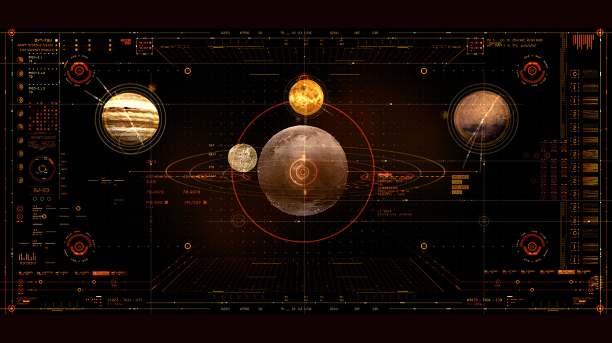
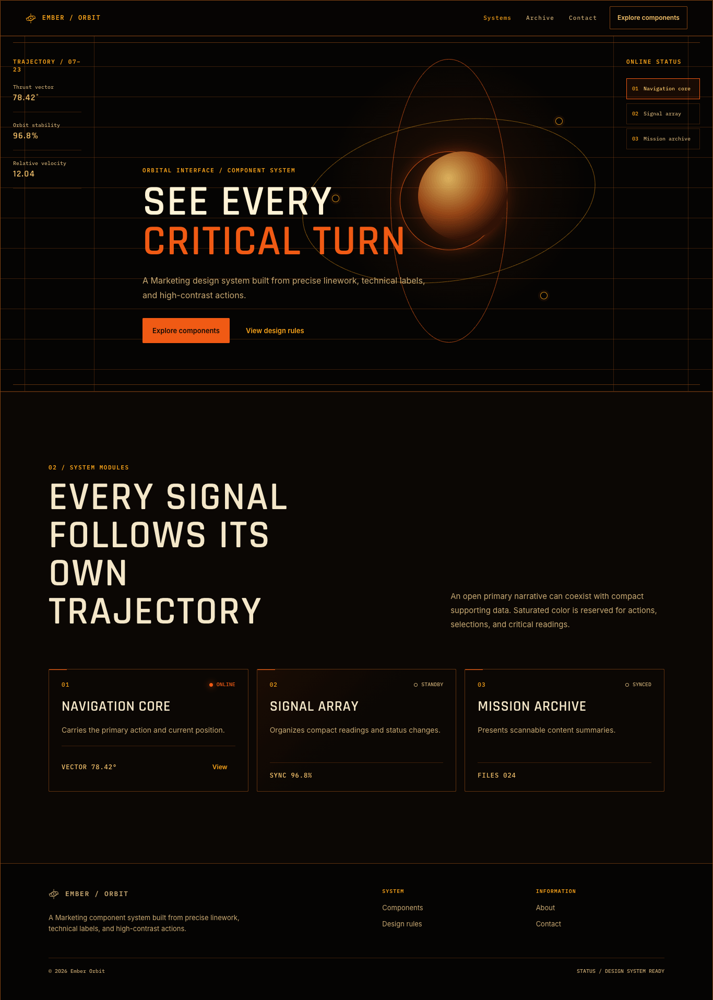

# Grilling Design System

[English](README.md) | [中文](README.zh.md)

[](https://skills.sh/GeoffZhu/grilling-design-system)

输入一张灵感图片，得到一套 UI 设计系统。

本 skill 用于从零构建 SaaS 管理后台 或 市场营销页面，亦可用于已有系统优化。

## 安装

```bash
npx skills add GeoffZhu/grilling-design-system
```

然后对你的编程助手说：

> 使用 grilling-design-system，以这张图片为灵感，确认设计系统。

## 使用示例

### 示例一

| 输入图 | 设计系统展示 |
| --- | --- |
|  |  |

### 示例二

| 输入图 | 设计系统展示 |
| --- | --- |
|  |  |
